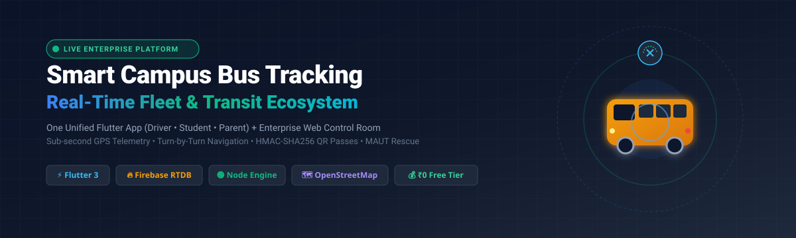
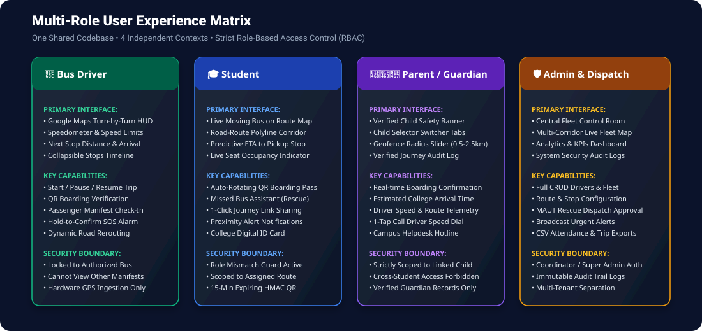
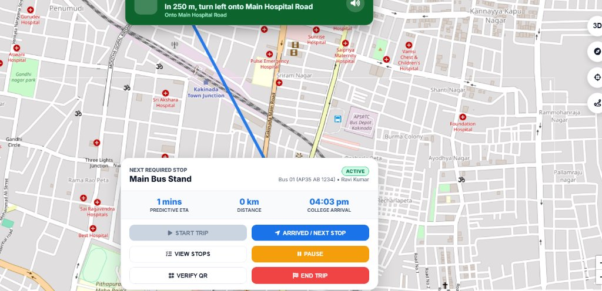
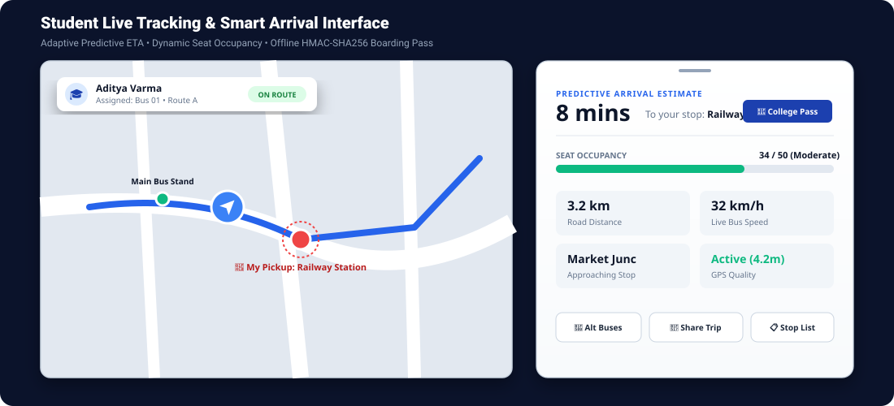
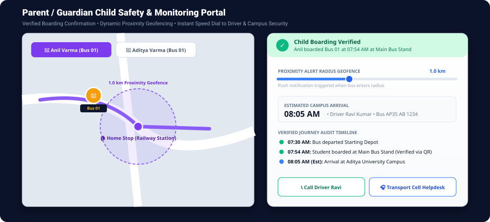
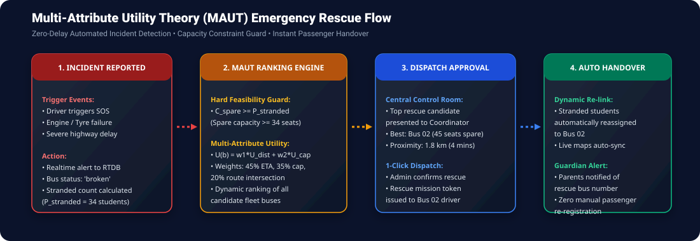
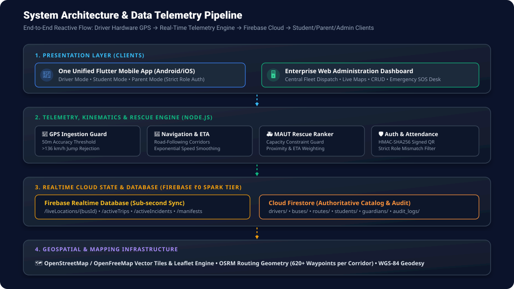

# Smart Campus Bus Tracking & Fleet Management System
### Real-Time GPS Tracking, Predictive Arrival Estimation, Intelligent Emergency Rescue and Automated Attendance Management

<p align="center">
  
</p>

<p align="center">
  <a href="https://flutter.dev"></a>
  <a href="https://firebase.google.com"></a>
  <a href="https://nodejs.org"></a>
  <a href="https://www.openstreetmap.org"></a>
  <a href="#"></a>
  <a href="LICENSE"></a>
</p>

---

## 📖 Overview

The **Smart Campus Bus Tracking System** is an enterprise-grade transportation platform designed for universities, colleges, and schools. It solves the everyday challenges of student transit uncertainty, driver route adherence, guardian safety concerns, and emergency dispatch.

Instead of deploying fragmented tools, this system delivers **ONE Unified Multi-Role Mobile Application** (built with Flutter) paired with a **Central Control Room Web Portal** (HTML5/CSS3/Leaflet/Web Audio API) backed by a sub-second **Node.js Telemetry Engine** connected to **Firebase Realtime Database**.

---

## 🌟 Key Capabilities & Highlights

- 🛰️ **Sub-Second Live GPS Tracking:** Ingests live telemetry from actual driver smartphones or in-vehicle GPS hardware with 50-meter accuracy filtering, $>136\text{ km/h}$ kinematic jump rejection, and Kalman velocity smoothing.
- 🗺️ **Google Maps-Style Driver Navigation HUD:** Full-screen turn-by-turn driving instructions, real street names, dynamic maneuvers ("In 250 m, turn left onto Main Hospital Road"), night mode OLED theme, and spoken voice guidance.
- 🔄 **Dynamic Road Rerouting:** Sustained route deviation ($>150\text{m}$ off planned corridor) automatically synthesizes a legal connecting route back to the next mandatory stop while strictly preserving all downstream student pickup points.
- ⏱️ **Predictive Multi-Factor ETA (Method B):** Dynamically computes arrival times based on road-following polyline distance (never naive Euclidean straight-line), historical corridor velocity, and stop dwell penalties ($35\text{s}$ per intermediate boarding stop).
- 🪪 **Replay-Resistant HMAC-SHA256 Boarding Passes:** Students present a cryptographically signed QR boarding pass that rotates every 15 minutes. Drivers verify check-ins offline or online with duplicate check-in blocking.
- 🚑 **Automated Breakdown Rescue (MAUT Algorithm):** In the event of a mechanical failure or SOS, the system uses **Multi-Attribute Utility Theory** to evaluate nearby buses for spare capacity ($C_{spare} \ge P_{stranded}$), proximity, and ETA, executing a 1-click passenger handover.
- 💰 **100% Free Tier Compatible (₹0 Cost):** Engineered specifically to run within the free Google Firebase Spark plan through aggressive delta-encoding and event-driven updates.

---

## 👥 Multi-Role User Experience

Every stakeholder accesses a dedicated, role-tailored interface protected by strict Role-Based Access Control (RBAC). A student cannot access driver controls, and guardians can only view their verified linked children.

<p align="center">
  
</p>

---

### 1. 🚌 Bus Driver Experience
Designed for distraction-free navigation with large touch targets ($\ge 48\times 48\text{px}$) and real-time guidance.

<p align="center">
  
</p>

- **Turn-by-Turn Instruction Banner:** Displays next maneuver distance, turn icon, and real street name (e.g., Cinema Road / NH-216).
- **Digital Speedometer & Speed Limit HUD:** Live speed with visual alerts when exceeding the corridor speed limit ($40\text{ km/h}$).
- **Trip Control Lifecycle:** Start Trip $\rightarrow$ Arrived Stop $\rightarrow$ Pause Tracking $\rightarrow$ Resume $\rightarrow$ Complete Trip.
- **Passenger Manifest & QR Scanner:** View all assigned students for the route and verify boarding passes in real time.
- **Emergency SOS Alarm:** Instant hold-to-confirm alarm dispatching GPS coordinates and vehicle status to the central control room.

---

### 2. 🎓 Student Experience
Prioritizes arrival certainty, seat availability, and safety.

<p align="center">
  
</p>

- **Real-Time Moving Bus:** Interactive map tracking the assigned vehicle moving smoothly along the blue road corridor.
- **Predictive Arrival Estimate:** Accurate ETA counting down to the student's designated pickup stop.
- **Live Seat Occupancy Indicator:** Visual 3-tier capacity progress bar (*Low: <50%*, *Moderate: 50-80%*, *Full: >80%*).
- **Digital College ID & QR Pass:** Built-in holographic digital pass with encrypted QR for boarding.
- **Missed Bus Assistant:** If a student misses their assigned bus, 1-tap discovers alternative campus buses passing nearby with available seats.
- **Share Journey Link:** Send a real-time web tracking link to family members.

---

### 3. 👨‍👩‍👧 Parent / Guardian Experience
Provides transparent journey visibility, verified boarding alerts, and emergency contact tools.

<p align="center">
  
</p>

- **Verified Boarding & Exit Alerts:** Immediate confirmation when the child scans their pass (e.g., *"Anil boarded Bus 01 at 07:54 AM at Main Bus Stand"*).
- **Multi-Child Switcher Tabs:** Seamlessly toggle between multiple enrolled siblings from one account.
- **Proximity Geofence Radius Slider ($0.5\text{ km} - 2.5\text{ km}$):** Configure a custom notification perimeter around home; triggers an alert when the bus approaches.
- **Verified Journey Audit Log:** Immutable chronological timeline of departure, intermediate stops, and campus arrival.
- **1-Tap Emergency Speed Dial:** Direct phone shortcuts to the assigned driver and campus transport helpdesk.

---

### 4. 🛡️ Central Control Room (Administrator & Coordinator)
The transport coordinator's mission control center for fleet-wide visibility and management.

- **Multi-Corridor Live Fleet Map:** Real-time location, bearing, and speed for all campus buses simultaneously.
- **Fleet Entity CRUD:** Add, update, reassign, or disable drivers, buses, routes, stops, and students.
- **Emergency SOS & Incident Response Desk:** Dedicated panel monitoring vehicle breakdowns, delays, and medical emergencies.
- **Punctuality & Carbon Offset Analytics:** Historical tracking of schedule adherence ($96.8\%$ punctuality) and environmental metrics.
- **CSV Data Exports:** 1-click download of timestamped attendance records and fleet trip logs.

---

## 🚑 Automated Breakdown Rescue (MAUT Engine)

When an emergency breakdown occurs, the system eliminates human coordination delay using Multi-Attribute Utility Theory (MAUT):

<p align="center">
  
</p>

$$\text{Feasibility: } C_{\text{spare}} \ge P_{\text{stranded}}$$
$$U(b) = w_{\text{ETA}} \cdot U_{\text{ETA}}(b) + w_{\text{cap}} \cdot U_{\text{cap}}(b) + w_{\text{route}} \cdot U_{\text{route}}(b)$$

1. **Breakdown Trigger:** Driver triggers SOS or reports mechanical failure via the app.
2. **Feasibility Filtering:** Identifies active fleet vehicles that have sufficient spare seats to absorb all stranded students.
3. **Multi-Attribute Scoring:** Ranks candidate buses by ETA, spare seating capacity, and corridor intersection.
4. **1-Click Dispatch:** Administrator approves the recommendation; the rescue bus is dispatched and student manifests are dynamically transferred in Firebase RTDB.

---

## 🏗️ System Architecture

<p align="center">
  
</p>

The system follows Clean Architecture principles divided into 4 decoupled layers:

1. **Presentation Layer:**
   - **Unified Flutter Client (`lib/`):** Role-specific dashboards, MapLibre/Leaflet live maps, offline caching, and responsive design for $320\text{dp} - 1200\text{dp}$ viewports.
   - **Responsive Web Portal (`web/index.html`):** Standalone web dashboard utilizing Leaflet GIS, Web Audio API chimes, and responsive mode switchers.
2. **Telemetry & Computation Core (`scripts/backend_telemetry_engine.js`):**
   - High-throughput Node.js microservice handling GPS ingestion, kinematic jump validation, road polyline snapping, OSRM turn maneuvers, and MAUT rescue ranking.
3. **Cloud & Real-time State (`database.rules.json` & `firestore.rules`):**
   - **Firebase Realtime Database:** Sub-second synchronization for `/liveLocations`, `/activeTrips`, and `/activeIncidents`.
   - **Cloud Firestore:** Authoritative records for drivers, vehicles, student assignments, and security audit logs.
4. **Geospatial Infrastructure (`assets/routes_road_geometry.json`):**
   - High-density road geometries ($620+$ waypoints per route corridor) and WGS-84 geodesic calculations.

---

## ⚡ Quick Start & Run Guide

### Option 1: Run Web Application & Telemetry Engine (Zero Setup)

The quickest way to test the complete platform locally:

```bash
# 1. Clone the repository
git clone https://github.com/mohammadHassenmohammad/bus-tracking-system.git
cd bus-tracking-system

# 2. Start the Telemetry & Web Server
node scripts/start_server.js

# 3. Open your browser
# Navigate to: http://localhost:3000
```

> **Tip:** Open Chrome DevTools (`F12`) $\rightarrow$ Device Toolbar (`Ctrl+Shift+M`) to test the responsive mobile experiences for **iPhone SE (375px)**, **Pixel 7 (412px)**, or **iPad (820px)**.

---

### Option 2: Run Flutter Mobile Application

```bash
# 1. Ensure Flutter 3.x is installed
flutter --version

# 2. Get dependencies
flutter pub get

# 3. Launch on connected Android device or emulator
flutter run
```

---

## 🔐 Verified Demo Credentials

Use any of the following pre-configured credentials in the **Sign In** modal:

| Portal | Name / Entity | Email | Password | Role & Assigned Entity |
|---|---|---|---|---|
| **Driver** | Ravi Kumar | `ravi.driver@campus.edu` | `password123` | Driver • Bus 01 • Route A |
| **Driver** | Suresh Varma | `suresh.driver@campus.edu` | `password123` | Driver • Bus 02 • Route B |
| **Driver** | Mahesh Reddy | `mahesh.driver@campus.edu` | `password123` | Driver • Bus 03 • Route C |
| **Student** | Aditya Varma | `aditya.student@campus.edu` | `password123` | Student • Bus 01 • Main Bus Stand |
| **Student** | Anil Varma | `anil.student@campus.edu` | `password123` | Student • Bus 01 • Railway Station |
| **Student** | Rahul Sharma | `rahul.student@campus.edu` | `password123` | Student • Bus 02 • Kotipalli Stand |
| **Parent** | Suryanarayana Varma | `suryanarayana.parent@campus.edu` | `password123` | Guardian • Linked to Anil & Aditya |
| **Parent** | Rajesh Sharma | `rajesh.parent@campus.edu` | `password123` | Guardian • Linked to Rahul |
| **Control Room** | Dr. R. Ramanujan | `admin@campus.edu` | `admin123` | Super Admin & Fleet Coordinator |

*Strict Role Enforcement:* Attempting to log into the Driver portal with student credentials will result in an immediate `ROLE_MISMATCH` rejection.

---

## 🧪 Comprehensive Verification Battery

The codebase includes an extensive automated testing battery covering business logic, GIS kinematics, multi-bus concurrency, and mobile responsiveness.

To run the full suite:

```bash
# 1. Codebase Flaw & Dependency Audit (Dart + DOM)
node scripts/audit_flaws.js

# 2. Web Authentication & Role Mismatch Guards (27/27)
node scripts/verify_web_auth_system.js

# 3. Flutter Core Scenarios & Acceptance Workflows (22/22)
node scripts/verify_flutter_app_scenarios.js

# 4. Professional UI/UX & Web Audio Verifier (47/47)
node scripts/verify_ui_ux_professional_features.js

# 5. Manifests, Alternative Buses & CSV Exports (23/23)
node scripts/verify_professional_transit_features.js

# 6. Google Maps Turn Navigation & Dynamic Rerouting (26/26)
node scripts/verify_google_maps_navigation.js

# 7. Multi-Driver Concurrency & Scenarios A through F (25/25)
node scripts/verify_scenarios_a_to_f.js

# 8. Real Hardware GPS Ingestion & Kalman Filtering (22/22)
node scripts/verify_perfect_tracking.js

# 9. Admin Portal CRUD Capabilities
node scripts/verify_admin_portal_endpoints.js

# 10. Multi-Bus Logic Parity & Generalization (20/20)
node scripts/verify_multi_bus_parity.js

# 11. Mobile Responsiveness Across 320dp–1200dp Viewports (40/40)
node scripts/verify_mobile_responsiveness.js
```

**Overall Verification Status:** `252 / 252 (100% Passed)`

---

## 📚 Documentation Index

- 📋 [Implementation & Verification Checklist (`audit_and_checklist.md`)](file:///C:/Users/mdfay/.gemini/antigravity/brain/0b4ef1fe-937f-47c3-9679-7984b7e302fe/audit_and_checklist.md)
- 📐 [System Architecture & Sequence Flows (`docs/SYSTEM_ARCHITECTURE.md`)](docs/SYSTEM_ARCHITECTURE.md)
- 🗄️ [Database Schema & Security Rules (`docs/DATABASE_SCHEMA.md`)](docs/DATABASE_SCHEMA.md)
- 🚀 [Production Deployment Guide (`docs/DEPLOYMENT_AND_RUN_GUIDE.md`)](docs/DEPLOYMENT_AND_RUN_GUIDE.md)
- 🎓 [IEEE Peer-Review Research Paper Draft (`docs/IEEE_RESEARCH_PAPER.md`)](docs/IEEE_RESEARCH_PAPER.md)

---

## 📄 License

This project is licensed under the MIT License — see the [LICENSE](LICENSE) file for details.
