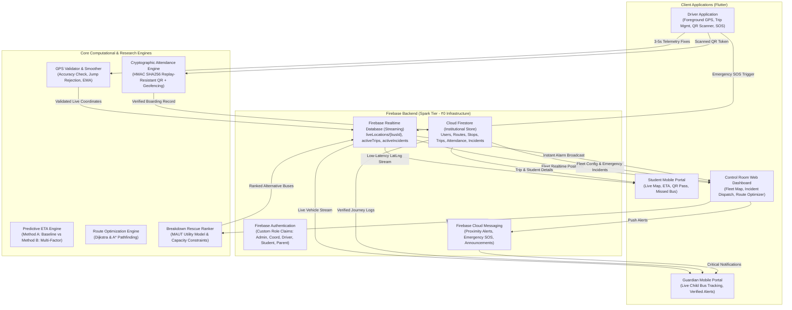
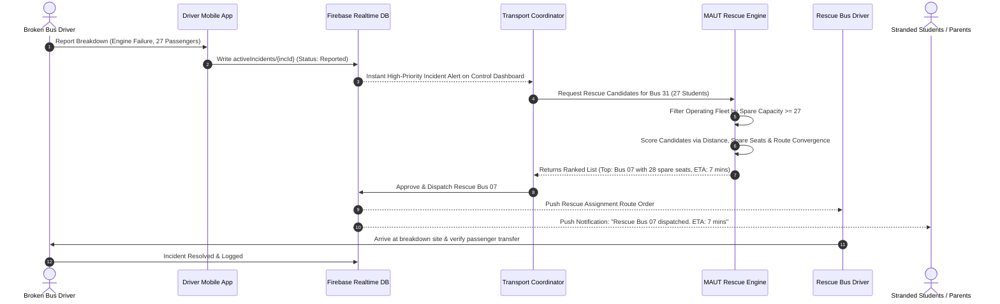
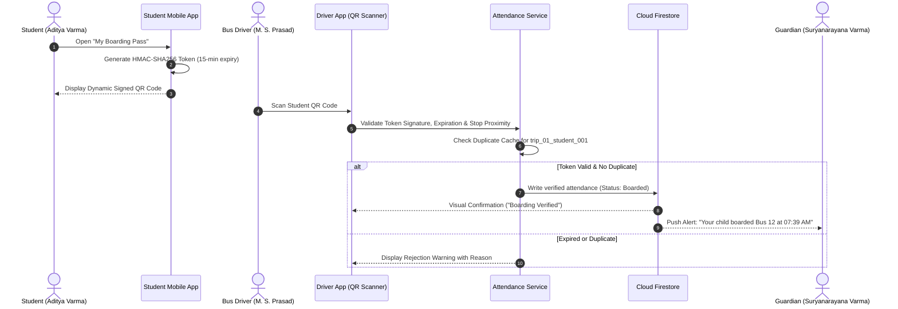
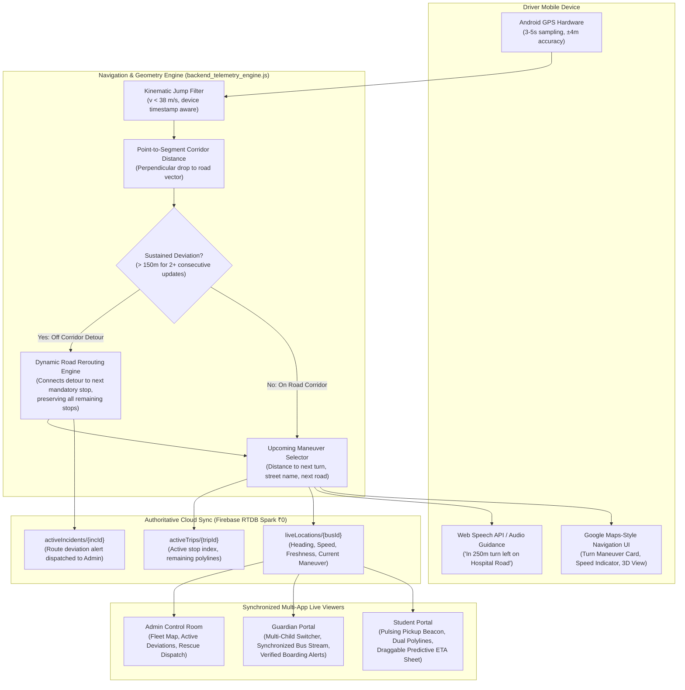

# Smart Campus Transport: System Architecture & Data Flow

## 1. High-Level System Architecture Diagram

---

## 2. Sequence Diagram: Emergency Breakdown & Capacity-Aware Rescue Dispatch

---

## 3. Sequence Diagram: Replay-Resistant QR Attendance & Parent Notification

---

## 4. Google Maps-Style Live Navigation & Dynamic Road Rerouting Architecture

### Key Technical Properties:
1. **Kinematic Jump & Temporal Filtering:** Rejects non-physical coordinate jumps (> 38 m/s / 136 km/h) while calculating elapsed time using physical device timestamps to prevent false rejections during high-frequency network arrivals.
2. **Shortest Valid Road Corridor:** Each route is backed by real OSM road coordinates, scheduled stops, and turn maneuver waypoints with actual street names.
3. **Sustained Deviation & Dynamic Road Rerouting:**
   - Single GPS outliers (< 150m or single jitter) do not trigger unnecessary rerouting.
   - Sustained deviation (> 150m for 2 or more consecutive fixes) activates the dynamic reroute engine.
   - The rerouted path connects the bus's detour position to the *next required mandatory stop*, strictly preserving all downstream intermediate stops so no boarding student is ever missed.
4. **Zero-Cost Multi-App Synchronization:** All applications (Driver, Student, Parent, Admin) subscribe to the unified authoritative Firebase Realtime Database node (`liveLocations/{busId}`), guaranteeing sub-second visual consistency at ₹0 infrastructure cost on the Firebase Spark tier.

